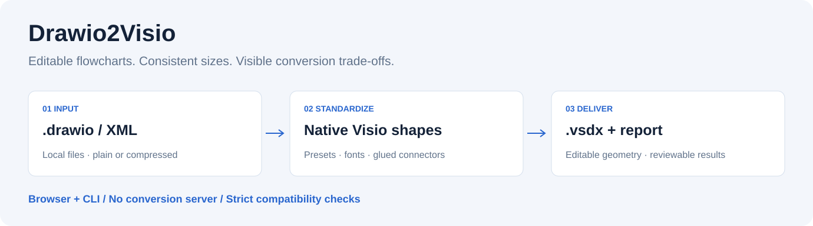
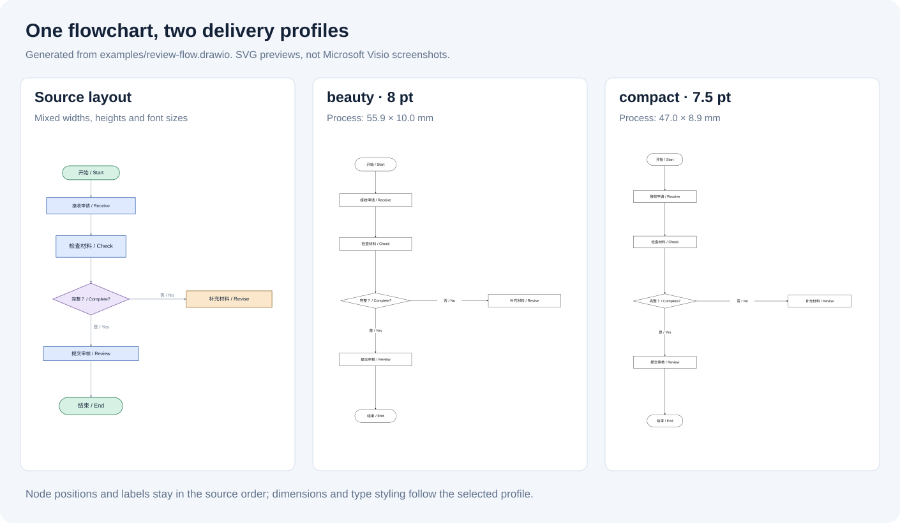

# Drawio2Visio

Turn Draw.io flowcharts into editable, consistently sized Visio documents, with visible conversion trade-offs.

[中文](README.md) · [Compatibility](docs/compatibility.md) · [Project comparison](docs/project-positioning.md)



Drawio2Visio focuses on flowchart delivery: separate size settings for processes, decisions and start/end shapes; themed fonts; native shape geometry; glued dynamic connectors; and a source-ID-based compatibility report. The browser workbench and Node CLI share the conversion core. Neither requires Microsoft Visio or a conversion server.

## Why this small tool exists

In research collaborations, diagrams may be drafted in Draw.io or generated by scripts, while a supervisor or collaborator still needs an editable Visio document. Rebuilding every box, label and connector in Visio adds repetitive work.

The intended workflow is: **draft in Draw.io → convert to editable Visio → inspect and refine in Visio**. This is useful when editable Visio is an actual delivery requirement. Notebook-based plotting, code-generated figures and interactive diagram editors serve different purposes; the project does not make assumptions about a user's age or preferred tools.

## Maintenance

This is a small, long-term practical project. The initial release covers the core workflow; improvements will follow real tasks and reproducible reports as time allows, with no fixed release schedule.

Please submit a minimal anonymized diagram, target Visio version and expected behavior through [GitHub Issues](https://github.com/cuifrost/drawio2visio/issues). Support boundaries and known limitations remain documented.



These previews are generated from [review-flow.drawio](examples/review-flow.drawio). They are SVG previews, not Microsoft Visio screenshots. Original node positions and text are retained; geometry, font size and styling follow the selected profile. Visio may re-route connectors differently.

## Quick start

Open `index.html` in a modern browser, or serve it locally:

```bash
python3 -m http.server 8765 --bind 127.0.0.1
```

Visit [http://127.0.0.1:8765](http://127.0.0.1:8765), load a diagram, review compatibility notes and export. Browser support for compressed input requires `DecompressionStream("deflate-raw")`.

For the CLI, install Node.js 18+ and run:

```bash
npm ci
node scripts/convert.js examples/review-flow.drawio -o outputs/review --strict
python3 scripts/check_vsdx.py outputs/review.vsdx --expect "提交审核"
```

Python 3.10+ is needed for validation and helper scripts. The CLI uses Node's built-in zlib for compressed input; it does not launch a browser or download a diagrams.net exporter.

Outputs: `.vsdx`, `-visio.svg`, `-report.json`, `-config.json`, and experimental `.vdx`. Portable config/report files store the input filename only; CLI stdout may include absolute paths.

## Reusable sizes and checks

```bash
node scripts/convert.js examples/review-flow.drawio -o outputs/compact --preset compact
node scripts/convert.js examples/review-flow.drawio -o outputs/custom --set fontSizePt=10 --set processWidth=2.5
node scripts/convert.js examples/review-flow.drawio -o outputs/natural --set forceSize=0
node scripts/convert.js examples/review-flow.drawio -o outputs/paper --profile templates/publication-profile.json --preset paper
node scripts/convert.js examples/compatibility.drawio --report-only --json
```

`--strict` rejects compatibility warnings before writing conversion files. `--report-only` inspects without exporting. Reports flag simplified shapes, omitted connectors, changed routing, nested geometry, images, rotation, estimated text overflow and overlaps. Text estimates are advisory, not font-rendering guarantees.

Multi-page input requires `--page 2` or `--page "Page name"`. Each invocation exports one selected page. The browser provides a page selector. Multi-page VSDX export is not implemented.

## Scope and verification

Supported inputs include plain `mxfile`, bare `mxGraphModel`, Base64/raw Deflate/URI-encoded diagrams and UserObject-wrapped labels. Rectangles, decisions, start/end shapes and plain text labels are standardized. Complex icons, data/database/document shapes, containers, images and swimlanes are not faithfully reproduced; relevant changes are reported.

Colors and rich text formatting are standardized. Source waypoints are not preserved. Dimensions can be normalized or retained; node positions are not automatically re-laid out. VSDX→Draw.io conversion is not supported.

The validator checks ZIP/XML, relationships, master references, Sheet references, connector endpoints and optional required text. Passing these checks does not prove visual fidelity in every Visio release. `.vdx` and the Windows COM implementation in `src/` are experimental; COM additionally requires Windows, Visio, pywin32 and a user-provided stencil.

## Development

```bash
npm test
npm run smoke
npm run docs:figures
```

CI is configured for Linux/macOS/Windows with Node 18/22. Actual CI status depends on running the workflow after publication. See [CONTRIBUTING.md](CONTRIBUTING.md) and [examples/README.md](examples/README.md).

## License and release

The initial public release is `v0.1.0`, under the [MIT License](LICENSE). It is a minimal practical tool for simple flowcharts, with structural regression tests and a checked local workflow. Complex diagrams and visual compatibility across Visio versions remain limited.

Built-in VSDX parts are generated by [scripts/build_skeleton.js](scripts/build_skeleton.js). Reference documents, Office stock icons and font binaries are not bundled. See [THIRD_PARTY_NOTICES.md](THIRD_PARTY_NOTICES.md).

This independent project is not affiliated with Microsoft, Visio, JGraph, draw.io or diagrams.net.
