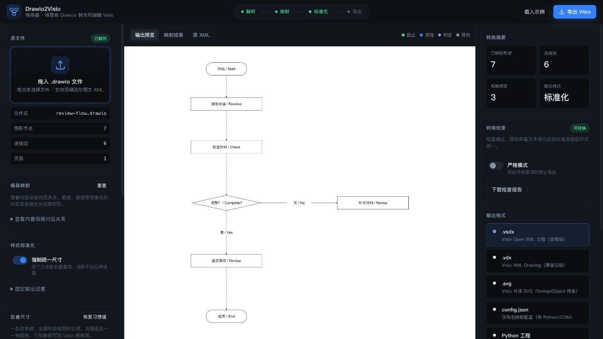
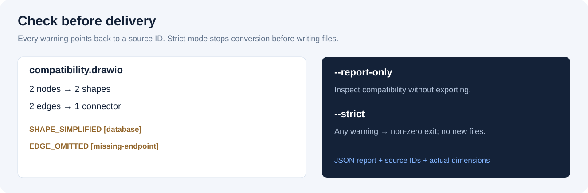

# Drawio2Visio

把 Draw.io 流程图交付成可继续编辑、尺寸一致、转换过程可检查的 Visio 文档。

[English](README.en.md) · [兼容性说明](docs/compatibility.md) · [方案对比](docs/project-positioning.md) · [自动化调用](docs/ai-agent-guide.md)


在 Draw.io 中快速起稿，在 Visio 中继续改字、改框和调整连接。Drawio2Visio 面向需要统一格式的审批流程、算法流程和技术附图：按形状类型批量设置宽高、统一字号，生成原生 Visio 形状和带吸附关系的连接线，并列出转换时的简化与遗漏。

浏览器版本和命令行共用转换核心。转换不需要安装 Microsoft Visio，也不需要把图上传到转换服务。

## 项目从哪里来

这个小工具来自一个实际的科研交付场景：起稿时可以用 Draw.io、脚本或 AI 辅助生成流程图，但接收方仍希望拿到 Visio 文件，继续调整文字、节点和连接线。重新在 Visio 中逐个拖流程块、对齐和修改格式，会消耗很多重复劳动。

Drawio2Visio 希望简化这一步：**在 Draw.io 中起稿，把结构转换成可编辑的 Visio，再做必要的人工检查和微调。** 它适合需要向导师、合作者或使用 Visio 的团队交付流程图的人。

选择什么绘图工具取决于协作方式和最终交付格式。Jupyter Notebook、代码绘图、Draw.io 和 Visio 可以分别用于不同环节；当接收方明确需要可编辑 Visio 时，这个转换步骤才有价值。

## 维护方式

这是一个小而长期维护的实用工具。先提供能完成核心流程的最小版本，后续会结合新的实际任务和可复现的问题逐步更新，不承诺固定更新周期。

欢迎通过 [GitHub Issues](https://github.com/cuifrost/drawio2visio/issues) 提供脱敏后的最小示例、目标 Visio 版本和预期效果。已有支持范围与限制会持续写在文档中，优先处理真实工作流中反复出现的问题。

## 看看实际效果


上图由 [review-flow.drawio](examples/review-flow.drawio) 和当前转换器生成。左侧按示例的原始尺寸、颜色和字号绘制；右侧两幅是实际 SVG 输出预览，**不是 Microsoft Visio 截图**。节点位置与文字保持，框尺寸和字号按预设统一。Visio 打开后的动态布线与字体可能有所不同。



## 为什么使用它

| 交付时常见的问题 | 本项目的处理 |
|---|---|
| 改完几个框后，整张图的尺寸又不一致 | 流程、判定、起止各有一组宽高；支持自定义 profile |
| 得到了一张图片，无法独立改字或改框 | VSDX 中写入形状、文字、几何公式和内置母版引用 |
| 移动节点后，连线脱离了框 | 写入两端 Connect 关系、触发器和动态连接公式 |
| 转换结束了，却不知道有没有丢内容 | 报告列出简化形状、遗漏连线和源节点 ID |
| 文件被导出了，问题要交付后才发现 | 严格模式在兼容性提示存在时停止；结构校验可检查关键文字 |
| 团队反复转换不同图，参数难以复用 | 网页预设、CLI profile 和 JSON 结果共用核心 |

本项目的特点是把**流程图标准化、原生连接约束、逐项检查和本地操作**放在同一条交付路径里。其他工具也可能支持其中的能力；这里不宣称“唯一”或“全格式无损转换”。

## 快速开始

### 浏览器

用现代浏览器打开 `index.html`，拖入 `.drawio` 或 `.xml`，查看输出预览和转换检查，再点击“导出 Visio”。

也可以在项目目录启动仅监听本机的静态服务：

```bash
python3 -m http.server 8765 --bind 127.0.0.1
```

访问 [http://127.0.0.1:8765](http://127.0.0.1:8765)。浏览器无需安装 Node.js；压缩输入要求浏览器支持 `DecompressionStream("deflate-raw")`。如浏览器不支持，可使用下方 CLI。

macOS 也可双击 `启动转换器.command`。示例按钮内置一个通用订单流程，其中的数据/数据库图形会产生简化提示，可以试用严格模式。

### 命令行

需要 Node.js 18 或更高版本。首次安装唯一的 Node 依赖：

```bash
npm ci

node scripts/convert.js examples/review-flow.drawio -o outputs/review --strict
python3 scripts/check_vsdx.py outputs/review.vsdx --expect "提交审核"
```

Python 3.10+ 用于结构校验和辅助脚本。CLI 直接生成 VSDX，不需要启动浏览器或下载旧版 diagrams.net。

每次转换输出：

| 文件 | 用途 |
|---|---|
| `review.vsdx` | 主要交付文件：可编辑 Visio 形状和连接线 |
| `review-visio.svg` | 标准化后的静态预览；不含 `foreignObject` |
| `review-report.json` | 兼容性提示、源 ID、实际尺寸和转换计数 |
| `review-config.json` | 本次参数与映射记录；只记录源文件名 |
| `review.vdx` | 实验性旧格式导出，未作为主要交付格式验证 |

结构校验通过说明 ZIP/XML、引用、母版和连接端点通过检查；**不代表已在所有 Visio 版本中完成视觉验证**。

## 调整尺寸和字号

```bash
# 更紧凑的流程图
node scripts/convert.js examples/review-flow.drawio -o outputs/compact --preset compact

# 按形状类型设置尺寸；in 是英寸，pt 是字号
node scripts/convert.js examples/review-flow.drawio -o outputs/custom \
  --set processWidth=2.5 --set processHeight=0.5 --set fontSizePt=10

# 保留源图每个节点的宽高
node scripts/convert.js examples/review-flow.drawio -o outputs/natural --set forceSize=0

# 复用团队或论文附图的 profile
node scripts/convert.js examples/review-flow.drawio -o outputs/paper \
  --profile templates/publication-profile.json --preset paper
```

| 预设 | 流程框 | 判定框 | 起止框 | 字号 |
|---|---|---|---|---|
| `beauty`（默认） | 55.9 × 10.0 mm | 54.1 × 11.9 mm | 32.0 × 10.0 mm | 8 pt |
| `compact` | 47.0 × 8.9 mm | 47.0 × 10.7 mm | 26.7 × 8.9 mm | 7.5 pt |
| `paper`（示例 profile） | 56.0 × 12.0 mm | 60.0 × 16.0 mm | 35.0 × 12.0 mm | 9 pt |

尺寸统一不会自动重排节点。文本标签保留源尺寸；页面按最终图形边界适配，并为负坐标及加宽后的图形留出边距。

## 先检查，再导出



```bash
# 只分析，不写转换文件
node scripts/convert.js examples/compatibility.drawio --report-only --json

# 有兼容性提示时返回非零退出码，不写本次转换产物
node scripts/convert.js examples/compatibility.drawio -o outputs/checked --strict --json
```

第二条命令预期失败：示例中的数据库图形被简化，另有一条连线引用不存在的节点。普通模式允许导出，并把这些问题写入报告。

报告中的 `ready` 表示本工具的输入检查未发现警告；`review` 表示需要检查简化、遗漏、估算文字溢出或重叠；`error` 表示空页、重复 ID、无效尺寸等输入错误。文字溢出只是字宽估算，不是字体渲染证明。

网页里的“严格模式”使用同样的检查结果；“下载检查报告”可保留诊断记录。

## 多页和批量输入

多页文件需要明确选择一页，防止不同页的同名节点串线：

```bash
node scripts/convert.js diagram.drawio -o outputs/page2 --page 2
node scripts/convert.js diagram.drawio -o outputs/review --page "审核流程"
```

网页加载多页文件后会显示页面选择器。目前每次输出一页 VSDX，尚未实现多页 VSDX 打包。

批量入口按标签长度估算框宽；如源目录有 `sizes.json`，优先使用其中的 `{"文件名不含扩展名": {"w": 英寸宽, "h": 英寸高}}`：

```bash
python3 scripts/batch_convert.py path/to/diagrams
python3 scripts/batch_convert.py --natural path/to/diagrams
```

## 支持范围

| 输入 | 当前行为 |
|---|---|
| 明文 `mxfile`、裸 `mxGraphModel` | 支持 |
| Base64 + raw Deflate + URI 编码 | CLI 支持；浏览器依赖解压能力 |
| 流程矩形、菱形判定、起止、文本标签 | 标准化为对应 Visio 形状 |
| HTML 文本、中文/英文标签、UserObject 包装 | 提取纯文字；格式统一 |
| 两端引用有效节点的连线 | 动态连接线；原折点/曲线会提示重布线 |
| 数据、数据库、文档及复杂图标 | 简化为流程矩形并报告 |
| 图片、嵌套容器、泳道、旋转 | 不做完整还原；报告相关风险 |
| Visio → Draw.io、自动绘图、自动布局 | 未实现 |

详细规则和错误码见 [兼容性说明](docs/compatibility.md)。Python COM 通道位于 `src/`，属于实验性备用实现，需要 Windows、Microsoft Visio、pywin32 和用户提供的 stencil；它与浏览器/Node 通道的能力不完全相同。

## 开发和贡献

```bash
npm test
npm run smoke
npm run docs:figures
```

测试覆盖压缩输入、多页选择、中文标签、预设与字号、生效尺寸、母版与连接引用、严格模式、元数据和损坏文件。GitHub Actions 已配置 Linux/macOS/Windows × Node 18/22；工作流实际结果以公开仓库运行记录为准。

`docs:figures` 从脱敏示例重建三幅 SVG 配图；网页截图为实际本地界面。复现步骤见 [examples/README.md](examples/README.md)，参与开发见 [CONTRIBUTING.md](CONTRIBUTING.md)。

```text
js/          浏览器和 Node 共用的解析、映射、导出与诊断
scripts/     CLI、批处理、结构校验、文档配图
examples/    可公开的虚构示例
tests/       输入解析、实际 VSDX 与故障回归
templates/   内置 skeleton 和可复用尺寸 profile
docs/        兼容性、定位对比和配图
src/         实验性 Windows COM 通道
```

## 许可证与版本

当前首发版本为 `v0.1.0`，采用 [MIT 许可证](LICENSE)。这是一个面向简单流程图的最小可用版本，已验证转换结构与本地工作流；复杂图形和不同 Visio 版本的视觉兼容性仍有待扩展。

内置 VSDX 包部件由 [scripts/build_skeleton.js](scripts/build_skeleton.js) 生成，不打包参考文档、Office 库存图标或字体文件。来源与依赖说明见 [THIRD_PARTY_NOTICES.md](THIRD_PARTY_NOTICES.md)。

本项目与 Microsoft、Visio、JGraph、draw.io 和 diagrams.net 无隶属或背书关系。产品名和商标属于各自权利人。
